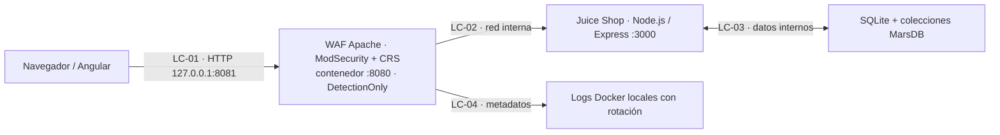

# Desarrollo Seguro — OWASP Juice Shop

Proyecto universitario de Desarrollo Seguro, UVG. Integra prácticas del **Secure SDLC** mediante una aplicación deliberadamente vulnerable y un laboratorio local aislado. El objetivo es relacionar objetivos de negocio, arquitectura, amenazas, requisitos verificables y evidencia antes de realizar pruebas ofensivas.

**Acceso verificado:** http://127.0.0.1:8081/ · **H1 preparado localmente, entrega académica pendiente.**

El puerto solicitado inicialmente, `8080`, devolvió una página de EnterpriseDB y Docker no pudo publicarlo. El propietario autorizó usar **8081**. No se detuvo ni modificó el servicio existente; `8080` ya no es destino de reconocimiento. Dentro del WAF se mantiene el puerto `8080`.

## Aplicación y alcance

[OWASP Juice Shop](https://owasp.org/www-project-juice-shop/) simula una tienda electrónica para formación en seguridad. Sirve una SPA Angular desde Node.js/Express, expone API REST y usa SQLite; la imagen inspeccionada también contiene colecciones MarsDB para pedidos y reseñas. No procesa compras reales. Su vulnerabilidad intencional permite estudiar controles, pero no acredita por sí sola una explotación concreta.

El trabajo cubre diseño, implementación verificable del laboratorio, pruebas y operación dentro del Secure SDLC. **En H1 solo se realizaron modelado, lectura de código y solicitudes HTTP normales.** Las pruebas ofensivas, remediación y monitoreo avanzado se reservan para hitos posteriores.

| Hito | Alcance previsto | Estado |
|---|---|---|
| H1 | PASTA 1–4, STRIDE, requisitos, casos de abuso y reconocimiento | Preparado y validado técnicamente; faltan cierre académico y capturas |
| H2 | Validación de vulnerabilidades, PoC y análisis de código/dependencias según consigna | No iniciado |
| H3 | Defensa, integración SIEM y ajuste de detección/bloqueo | No iniciado; sin Elasticsearch ni Kibana |
| H4 | Integración y entrega final | No iniciado; confirmar detalle en la rúbrica original |

La rúbrica y la guía de IA de UVG no fueron suministradas. El checklist se basa en la solicitud y el kit; no certifica cumplimiento íntegro de esos documentos.

## Equipo

| Integrante | Rol | Responsabilidad |
|---|---|---|
| Gegdgt, propietario del repositorio | Red Team | Reconocimiento, inventario de entradas, hipótesis y evidencias |
| Sebas Juárez | Blue Team | Arquitectura, WAF, límites de confianza y controles |
| Por confirmar | Segundo Red Team | Apoyar reconocimiento y revisión |
| Por confirmar | Segundo Blue Team | Apoyar controles y revisión |

## Arquitectura



Solo WAF publica un puerto, ligado a loopback. La red `interna` tiene `internal: true`; Juice Shop está conectado únicamente a ella. WAF también usa `entrada`, una red bridge. No hay servicio independiente de base de datos ni SIEM. La SPA se ejecuta en el navegador. Un administrador del host/Docker sigue teniendo acceso privilegiado: esta separación no lo convierte en un actor no confiable aislado.

**Límites:** LC-01 separa entradas del cliente del proxy; LC-02 separa inspección WAF de validación/autorización en la API; LC-03 separa lógica de negocio de acceso a datos; LC-04 separa los servicios de los registros administrados por Docker. LC-03 es lógico: los almacenes comparten proceso/contenedor y no tienen aislamiento propio. [DFD completo](docs/hito-1/02-PASTA-3-DFD.md).

## Tecnologías y versiones observadas

| Tecnología | Resultado de inspección |
|---|---|
| Windows / WSL | Windows; Ubuntu con WSL 2 |
| Git | 2.52.0.windows.1 |
| Docker / Compose | 29.8.1 / v5.5.1 |
| Juice Shop / Node.js | 20.4.0-SNAPSHOT / v24.22.2, imagen oficial fijada por digest |
| WAF | Apache 2.4.69, ModSecurity 2.9.15, OWASP CRS 4.30.0 |
| Diagramas | Graphviz 12.2.1 y Mermaid |

Las etiquetas `latest` y `apache` usadas para resolver las imágenes eran mutables. [Compose](entorno-blue-team/compose.yaml) utiliza ahora sus digests SHA-256. La versión de Juice Shop observada es **SNAPSHOT**, no se presenta como release estable. Cambiar imágenes exige repetir la verificación y revisar el DFD.

## Requisitos en Windows

1. Git y PowerShell; Docker Desktop iniciado con contenedores Linux y backend WSL 2.
2. Virtualización y WSL 2 habilitados; comprobar `wsl --status`.
3. Puerto `127.0.0.1:8081` disponible y acceso a Docker Hub para descargar las imágenes.
4. Navegador para la interfaz y DevTools. VS Code es opcional.
5. Python 3.10+ solo para los scripts de validación y evidencia. Graphviz solo si se regeneran los diagramas; no hacen falta para arrancar el laboratorio.

## Instalación reproducible

Hasta publicar los cambios locales, un clon del remoto actual **no incluye estos entregables**. Después de la publicación autorizada, o usando esta copia local:

```powershell
git clone https://github.com/Gegdgt/Proyecto_Final_Desarrollo_Seguro.git
cd Proyecto_Final_Desarrollo_Seguro
git remote -v
docker version
docker compose version
docker compose -f .\entorno-blue-team\compose.yaml config
docker compose -f .\entorno-blue-team\compose.yaml up -d
docker compose -f .\entorno-blue-team\compose.yaml ps
curl.exe --noproxy '*' --max-time 15 -I http://127.0.0.1:8081/
```

Abrir **http://127.0.0.1:8081/**. Esperar a que ambos contenedores indiquen `healthy`. Confirmar que el contenido es Juice Shop: un HTTP 200 de otra aplicación no basta. El healthcheck de Juice Shop usa `/nodejs/bin/node`, la ruta real de Node en esta imagen.

```powershell
# Estado, configuración y registros (no publicar logs crudos).
docker compose -f .\entorno-blue-team\compose.yaml ps
docker compose -f .\entorno-blue-team\compose.yaml logs --tail=30 waf
docker compose -f .\entorno-blue-team\compose.yaml logs --tail=30 juice-shop
docker compose -f .\entorno-blue-team\compose.yaml port waf 8080
docker inspect juiceshop-h1-juice-shop-1 --format '{{json .HostConfig.PortBindings}}'
# Verificaciones locales; el recolector hace únicamente GET normales.
python .\scripts\validar-h1.py
python .\scripts\recopilar-evidencia-h1.py
# Pausar y reanudar sin retirar los contenedores.
docker compose -f .\entorno-blue-team\compose.yaml stop
docker compose -f .\entorno-blue-team\compose.yaml start
# Retirar los contenedores y las redes del laboratorio.
docker compose -f .\entorno-blue-team\compose.yaml down
```

No hay volúmenes de datos persistentes configurados. `down` retira los datos de las capas de contenedores y sus logs. Además, el código de arranque recrea las tablas SQLite: no se promete persistencia de cuentas/progreso al reiniciar. Guardar evidencia sanitizada antes de detener o recrear. `restart: unless-stopped` puede reanudar el laboratorio con Docker Desktop; usar `stop` al terminar de trabajar.

## Diseño seguro y entregables

PASTA I define objetivos e impacto; II delimita tecnología y actores; III descompone procesos, almacenes y flujos; IV analiza amenazas. STRIDE se utiliza dentro de IV para cubrir suplantación, manipulación, repudio, divulgación, denegación de servicio y elevación de privilegios. No equivale a completar las siete etapas de PASTA.

| Entregable | Enlace |
|---|---|
| Índice y estado H1 | [README de H1](docs/hito-1/README.md) |
| PASTA I–II | [Objetivos y alcance](docs/hito-1/01-PASTA-1-2.md) |
| PASTA III | [DFD y límites](docs/hito-1/02-PASTA-3-DFD.md) |
| PASTA IV | [Matriz STRIDE](docs/hito-1/03-PASTA-4-STRIDE.md) |
| Requisitos y casos | [Criterios de aceptación](docs/hito-1/04-Requisitos-y-casos-de-abuso.md) |
| Red Team | [Reconocimiento](docs/hito-1/05-RedTeam-reconocimiento.md) |
| Blue Team | [Configuración](docs/hito-1/06-BlueTeam-configuracion.md) |
| Revisión | [Checklist](docs/hito-1/07-CHECKLIST.md) |
| Diagramas | [PNG](docs/hito-1/DFD-referencia.png), [SVG](docs/hito-1/DFD-referencia.svg), [DOT](docs/hito-1/DFD-referencia.dot) |
| Evidencia técnica | [Índice](docs/hito-1/evidencias/README.md), [bitácora](docs/hito-1/evidencias/VERIFICACION.md) |
| Fork obligatorio | [Migración sin destruir el repositorio](docs/hito-1/08-Migracion-fork.md) |
| Procedencia y declaración IA | [Fuentes y uso de IA](docs/hito-1/09-Fuentes-y-uso-IA.md) |

## Normas de seguridad

El único destino de reconocimiento autorizado es `127.0.0.1:8081`, por aprobación explícita del propietario. No realizar pruebas contra Juice Shop público, UVG, terceros ni contra EnterpriseDB en 8080. Usar datos ficticios; nunca contraseñas reales. En H1 no se ejecutan fuerza bruta, escáneres masivos, explotación ni pruebas destructivas.

El WAF está en **DetectionOnly**: observa, no garantiza bloqueo. HTTP sin TLS es una excepción documentada para loopback; no desplegar esta configuración en Internet. Los logs pueden contener información sensible aun con auditoría reducida: revisarlos y redactarlos antes de versionar. No subir cookies, JWT, archivos HAR crudos ni credenciales.

## Problemas frecuentes

| Síntoma | Diagnóstico / solución |
|---|---|
| No existe `dockerDesktopLinuxEngine` | Iniciar Docker Desktop, habilitar contenedores Linux y verificar `docker info`; fue el bloqueo inicial observado |
| `ports are not available` en 8080 | Conflicto observado con página de EnterpriseDB; usar la configuración autorizada 8081, sin detener servicios ajenos |
| 8081 ocupado | Identificar propietario; no cambiar a `0.0.0.0`. Acordar otro puerto y actualizar alcance, scripts y DFD antes de probar |
| `node` no encontrado en healthcheck | La imagen usa `/nodejs/bin/node`; no sustituirlo por un ejecutable supuesto |
| Respuesta vacía / 502 al iniciar | Esperar `healthy`, revisar logs, DNS interno y `BACKEND=http://juice-shop:3000` |
| Advertencias de Alchemy/LLM | Dependencias externas fuera de H1; la red interna restringe salida. No añadir claves ni servicios para esos retos |
| Advertencia de certificado/stapling | La imagen crea un certificado propio para 8443, puerto no publicado; la verificación H1 es HTTP local |
| WAF permite solicitudes con alertas | Es el modo esperado; una alerta por Host numérico no confirma ataque |
| Rutas antiguas no coinciden | Usar la evidencia de la imagen fijada; no asumir rutas de otras versiones |

## Referencias

- [OWASP Juice Shop](https://owasp.org/www-project-juice-shop/) y [guía oficial de ejecución](https://pwning.owasp-juice.shop/companion-guide/latest/part1/running.html).
- [Imagen oficial ModSecurity + CRS](https://github.com/coreruleset/modsecurity-crs-docker): variables, auditoría y proxy.
- [Docker Desktop para Windows](https://docs.docker.com/desktop/setup/install/windows-install/), [redes Compose](https://docs.docker.com/compose/how-tos/networking/) y [publicación de puertos](https://docs.docker.com/engine/network/port-publishing/).
- [PASTA — VerSprite, coautor de la metodología](https://versprite.com/cybersecurity-listings/devsecops/pasta-threat-modeling/).
- [OWASP Threat Modeling](https://owasp.org/www-community/Threat_Modeling) y [OWASP Cheat Sheet Series](https://cheatsheetseries.owasp.org/).
